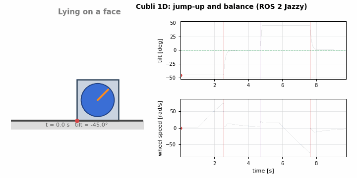
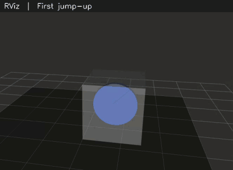

# Cubli control (ROS 2 Jazzy)

Cubli control in ROS 2 for the **1D Cubli**: a cube that jumps up from lying on a face and
balances on one edge with a single reaction wheel.

| Phase | What | Status |
|---|---|---|
| 1 | Simulator, jump-up + LQR controller, RViz | ✅ done in simulation |
| 2 | Realistic sensors (MPU6050 IMU + encoder) and a state estimator | ✅ done in simulation |
| 3 | Real hardware: ESP32 + MPU6050 + Nidec 24H firmware and ROS driver | 🚧 software ready and tested against a fake ESP32; not yet run on a real cube |

The same estimator and controller run on the simulator and on the real cube; only the
node that produces the raw sensor data changes.

## Phase 1 results: 1D jump-up and edge balancing (simulation)



*Recorded from a live `ros2 launch` run (sim + controller nodes at 200 Hz): the cube jumps up
from a face, balances, is pushed over (6 rad/s), then jumps back up from the other side.*



*Screen recording of RViz during `ros2 launch cubli_control cubli_sim.launch.py`, cropped to the
3D view and trimmed: the first jump-up from a face, then two knock-overs with
`ros2 topic pub --once /cubli/push std_msgs/msg/Float64 "{data: 6.0}"`, each followed by an
automatic jump back up.*

**Jump-up** (both directions measured from the run above, first-try success each time)

| Metric | Result |
|---|---|
| Wheel spin-up (0.03 N·m) | 1.54 s from rest (1.82 s when the wheel first has to reverse) |
| Wheel speed at brake | ±74.0 rad/s (ideal 68.1 rad/s × 1.1 margin) |
| Body rate right after brake | ±6.82 rad/s |
| Brake → LQR engaged (tilt < 11.5°) | 0.13 s |
| Brake → tilt within ±1° | 0.43 s |
| Peak balancing torque | 0.08 N·m (32% of the 0.25 N·m limit) |
| Tilt 2 s after catch | 0.17°; the wheel spins down slowly (3.2 rad/s left) |

**Balancing robustness** (offline sweeps of the same model and controller)

| Test | Result |
|---|---|
| Recovers from a tilt at rest | up to 11.2°, the controller's engage limit (0.2 rad) |
| Absorbs a push without falling | up to 4.1 rad/s; 5 rad/s and above knock it over, then it jumps back up |
| Lossy brake (`brake_efficiency`) | ≥ 0.95 succeeds on the first jump; 0.90 succeeds on the retry (margin 1.15) |
| Sample delay | stable with one control step (5 ms) of actuation delay |

**Controller:** discrete LQR (200 Hz) on [θ_b, θ̇_b, θ̇_w] with Q = diag(100, 1, 1e-4),
R = 100, which gives K = [−1.615, −0.162, −0.001]. The open-loop upright pole is +9.86 rad/s;
the closed-loop discrete poles have magnitudes 0.891, 0.951 and 0.996, the slowest being the
wheel-speed mode.

**Verification:** 13 offline tests pass (`pytest`), covering open-loop instability,
closed-loop stability, tilt recovery, brake momentum conservation, floor contact, and jump-up
from both faces. The full sequence was also checked live through `ros2 launch`.

**Limitations of Phase 1:** simulation only, with perfect state feedback (no IMU noise,
bias or filtering), an ideal instantaneous brake, and the paper's parameters rather than
measured ones. The GIFs above were recorded with perfect state; to reproduce them, launch with
`sensors:=false`.

## Phase 2: sensors and state estimation (simulation)

The controller no longer sees the true state. The simulator now outputs what the real
sensors would, and a new estimator node rebuilds `/joint_states` from them:

- **IMU (MPU6050 model)** at the cube centre, 106 mm from the edge: gyro noise 0.003 rad/s and
  bias 0.02 rad/s (~1.1°/s); accelerometer noise 0.04 m/s² and biases of 0.03 and −0.05 m/s².
  The accelerometer also feels the cube's own centripetal and tangential acceleration.
- **Wheel encoder:** quantised to 400 counts per turn.
- **Estimator** ([estimator.py](src/cubli_control/cubli_control/estimator.py)):
  - Gyro-bias calibration while the cube lies still for its first second.
  - A complementary filter (time constant 0.5 s since tuning; 0.3 s for the results below) that integrates the gyro and corrects the
    tilt with the accelerometer. The accelerometer reading is lever-arm compensated, and the
    correction is skipped during jumps and impacts.
  - Wheel speed from encoder differences over 40 ms.

**Results** (measured through `ros2 launch`, with estimates compared to the sim's ground truth)

| Metric | Result |
|---|---|
| Gyro bias found by calibration | +0.0202 rad/s (true +0.0200) |
| Starting tilt from calibration | −45.09° (true −45.00°) |
| Jump-up, knock-over, jump-up again | both jumps succeed first try |
| Tilt estimate error while balancing | +0.175° mean, 0.024° std |
| Body-rate / wheel-speed error (std) | 0.003 rad/s / 0.17 rad/s |

The constant +0.175° tilt error is the accelerometer's 0.03 m/s² bias (0.03/9.81 rad). The
controller handles it without help: the wheel settles at a few rad/s and keeps the *true*
tilt near 0°. On hardware, measure this offset and set `angle_offset`.

**Robustness** (offline, 3 random seeds each, jump-up from a face then balance; all passed with
no failed jumps or falls)

| Sensor case | Tilt error (mean / std) |
|---|---|
| Default sensors | 0.17° / 0.05° |
| 3× gyro and accelerometer noise | 0.21° / 0.07° |
| Large biases (gyro 0.15 rad/s, accelerometer 0.3 m/s²) | 1.77° / 0.09° |
| Coarse encoder (100 counts per turn) | 0.17° / 0.05° |
| IMU 3 cm from the edge instead of 10.6 cm | 0.18° / 0.04° |
| All of the bad cases combined | 1.79° / 0.07° |

A filter time constant of 0.2–0.5 s works best; above 1 s, uncorrected gyro drift starts to
show (0.13° std at 1 s, 0.24° at 2 s).

## Phase 3: ESP32 + MPU6050 + Nidec 24H hardware

```
 MPU6050 ─I2C─┐                       USB serial, 460800 baud
 Nidec 24H ───┤ ESP32 firmware ◄──────────────────────────► hw_driver_node ─► estimator ─► controller
 (PWM/DIR/    │ 200 Hz frames               $S,... sensor frames  /imu/data_raw       /joint_states
  brake/enc) ─┘ 100 ms watchdog             $T,$B,$E commands     /cubli/wheel_encoder
```

- **Firmware:** [firmware/cubli_esp32/cubli_esp32.ino](firmware/cubli_esp32/cubli_esp32.ino)
  needs only the ESP32 Arduino core (2.x or 3.x). It reads the MPU6050 directly over I2C
  (±500°/s, ±2 g, 44 Hz low-pass) and counts the encoder with interrupts. It drives the
  Nidec's inverted PWM, direction and brake pins, and stops the motor if commands stop for
  100 ms. The motor starts disabled until the driver connects.
- **Driver:** [hw_driver_node.py](src/cubli_control/cubli_control/hw_driver_node.py)
  publishes the same raw topics as the simulator. It remaps the IMU axes to the body frame
  and stamps frames with the ESP32's clock, so the estimator gets jitter-free timing. It turns
  torque into Nidec effort with a DC-motor model that includes back-EMF, and reconnects on
  its own if the USB cable is unplugged.
- **Protocol:** ASCII lines with an NMEA-style XOR checksum; corrupt lines are dropped. See
  [hardware.py](src/cubli_control/cubli_control/hardware.py).
- **Fake ESP32:** `fake_esp32` runs the Phase 2 physics and sensor models behind a virtual
  serial port and speaks the same protocol. This tests the whole hardware path without a board.

**Tested without hardware:** the full chain (fake ESP32 → serial → driver → estimator →
controller) ran at 199 frames/s with 0 bad lines, one frame every 5 ms (see the serial-read fix
under *Controller tuning*). With `jump_up:=true` it jumped up, balanced,
was knocked over (`kill -USR1 <fake_esp32 pid>`), and jumped back up. Ctrl+C shuts every node
down cleanly. The firmware passes a g++ syntax check against Arduino API stubs for ESP32 core
2.x and 3.x, but has **not been compiled for an ESP32 or run on a board**.

### Wiring (defaults; change the constants at the top of the sketch)

| ESP32 pin | Connects to | Notes |
|---|---|---|
| GPIO 21 / 22 | MPU6050 SDA / SCL | 3.3 V, I2C at 400 kHz |
| GPIO 25 | Nidec PWM | inverted: 100% duty = stopped |
| GPIO 26 | Nidec CW/CCW | |
| GPIO 27 | Nidec START/STOP (brake) | `BRAKE_ACTIVE = LOW`; check your motor |
| GPIO 32 / 33 | Nidec encoder A / B | internal pull-ups to 3.3 V; don't pull up to 5 V |
| GPIO 13 (optional) | brake servo signal | set `PIN_SERVO = 13` |
| GND | Nidec GND, MPU6050 GND | shared ground with the motor supply |

Power the Nidec from its own 12 V (or 24 V, depending on the model) supply, not from the ESP32.
Mount the MPU6050 so one axis lies along the balancing edge.

### Bring-up

1. Give your user serial-port access once (then log out and back in):
   ```bash
   sudo usermod -aG dialout $USER
   ```
2. Flash the sketch with the Arduino IDE: install the ESP32 boards package, pick your board,
   open `firmware/cubli_esp32/cubli_esp32.ino` and upload it.
3. **Sensors only:** run the driver without the controller, then tilt the cube by hand.
   ```bash
   ros2 launch cubli_control cubli_hw.launch.py controller:=false
   ```
   Check `/imu/data_raw`: the edge-axis gyro should read positive when the tilt (body
   `/joint_states` position) increases. Fix `imu_axes` in
   [cubli_hw.yaml](src/cubli_control/config/cubli_hw.yaml) until it does. Then check that
   positive effort (`/cubli/raw_effort`, below) makes the encoder count up; if not, set
   `encoder_sign: -1`.
4. **Measure** the values marked `MEASURE` in `cubli_hw.yaml`:
   - `encoder_cpr`: turn the wheel exactly once by hand.
   - `no_load_speed` and `stall_torque`: hold the cube and drive the motor directly
     (the driver's watchdog needs commands at least every 100 ms, hence `-r 50`):
     ```bash
     ros2 topic pub -r 50 /cubli/raw_effort std_msgs/msg/Float64 "{data: 0.3}"
     ```
     Plot `/cubli/wheel_encoder` or the wheel speed in `/joint_states`. Then
     no_load_speed = steady speed / 0.3, and stall_torque = Θ_w × (starting acceleration) / 0.3.
   - `angle_offset`: balance the cube by hand and read the estimated tilt.
   - Also measure the real masses and inertias and put them in `CubliParams` in
     [model.py](src/cubli_control/cubli_control/model.py), so the LQR is designed for your cube.
5. **Balance:** keep the cube still on a face for the first second (gyro calibration), then
   lift it to within about 11° of balanced. The controller takes over.
   ```bash
   ros2 launch cubli_control cubli_hw.launch.py
   ```
   For a balance loop that doesn't depend on the PC, add `onboard:=true` (see below).

**About jump-up on hardware:** jumping needs the wheel stopped almost instantly. The Nidec's
built-in brake is electrical and much too slow, so jump-up is off on hardware by default.
To try it, add a servo-driven mechanical brake (`PIN_SERVO`), then launch with
`jump_up:=true`. If the jumps fall short, the controller raises the wheel speed by 5% per try.

Try the hardware stack with no board:
```bash
ros2 launch cubli_control cubli_hw.launch.py fake_hardware:=true jump_up:=true
```

### On-board balance mode (balance loop on the ESP32)

By default the PC closes the balance loop: every 5 ms a sensor frame goes over USB to the
driver, the estimator and the controller, and a torque command comes back. If the PC is
busy, that round trip gets late and catches fail (see *Result under load* below). In
on-board mode **the ESP32 runs the estimator and the LQR itself at 200 Hz** and drives the
motor straight from each IMU sample. USB and the PC are out of the time-critical loop.

- **Estimator on the ESP32:** the same algorithm as
  [estimator.py](src/cubli_control/cubli_control/estimator.py): gyro-bias calibration over
  the first still second, a complementary filter (τ = 0.5 s) with lever-arm compensation
  (IMU 0.106 m from the edge), and wheel speed from an 8-sample encoder difference.
- **LQR on the ESP32:** u = −K [tilt, rate, wheel speed], limited to `max_torque`, then
  turned into Nidec effort with the same back-EMF model as the driver. It uses the same
  hysteresis as the PC controller. It takes over within `engage_angle`, or within
  `catch_angle` for `jump_timeout` after a brake pulse (the jump). It gives up beyond
  `disengage_angle` while still moving away from upright, or beyond `catch_angle`.
- **What stays on the PC:** the jump-up state machine (rest, spin-up, brake) and
  supervision. While the ESP32 is not balancing it applies the PC's `$T` commands as usual
  (spin-up). While it balances it ignores them. The controller's BALANCE mode then simply
  follows what the ESP32 reports.
- **Setup on connect:** the driver designs K with `lqr_gain` from the `cubli_controller`
  weights in [cubli_hw.yaml](src/cubli_control/config/cubli_hw.yaml). It sends K, the angles,
  motor and estimator parameters, and the IMU axes, then switches the ESP32 to on-board mode.
  Both loops therefore always use the same tuning. If the ESP32 resets by itself (e.g. a
  brownout), the driver notices that the estimates stopped and sends the setup again.
  `lqr_delay_steps` is ignored on board: there is no transport delay left to model.
- **Safety:** the motor still starts disabled until `$E,1`. If no valid line arrives from the
  PC for 2 s (the driver sends one at least every 100 ms), the ESP32 stops balancing and
  stops the motor. If an IMU read fails, it stops balancing.
- **Topics:** the ESP32's estimate replaces the estimator node on `/joint_states` (the
  launch file doesn't start the estimator in this mode). Its mode is published on
  `/cubli/onboard_mode` (`CALIBRATING`, `IDLE`, `BALANCE`, latched). `/cubli/mode` is still
  the controller's overall mode (FALLEN → SPIN_UP → JUMPING → BALANCE), and its BALANCE
  now comes from the ESP32. The raw `/imu/data_raw` and `/cubli/wheel_encoder` keep flowing
  for plotting.

**Protocol additions** (details in [hardware.py](src/cubli_control/cubli_control/hardware.py)
and the sketch header):

| Direction | Message | Meaning |
|---|---|---|
| PC → ESP32 | `$M,<0\|1>` | 0 = passthrough (default), 1 = on-board balance; 1 restarts calibration |
| PC → ESP32 | `$K,<k1>,<k2>,<k3>` | LQR gain |
| PC → ESP32 | `$P,<name>,<value>` | `engage`, `disengage`, `catch`, `jump_timeout`, `max_torque`, `stall_torque`, `no_load_speed`, `max_effort`, `angle_offset`, `tau`, `imu_offset`, `cpr`, `enc_sign` |
| PC → ESP32 | `$A,<ax>,<ay>,<az>` | body axes from sensor axes (same as `imu_axes`), e.g. `$A,+x,-z,+y` |
| ESP32 → PC | `$X,<t_us>,<tilt>,<rate>,<wheel_speed>,<torque>,<mode>` | on-board estimate after every `$S`; mode 1 calibrating, 2 idle, 3 balancing |

`$S` frames keep streaming unchanged. Together with `$X`, the link carries about 24 kB/s,
about half of what 460800 baud allows.

#### How to run it

On-board mode is off by default. Turn it on with `onboard:=true`; all other launch arguments
work as before.

1. **Without a board (fake ESP32)**, from `cubli_ws`:
   ```bash
   colcon build --symlink-install
   source install/setup.bash
   ros2 launch cubli_control cubli_hw.launch.py fake_hardware:=true onboard:=true jump_up:=true
   ```
   In the log you should see `On-board balance: K = [...] sent to the ESP32`, then
   `ESP32 on-board mode: CALIBRATING` → `IDLE`. The controller spins up and brakes. The
   fake prints `on-board mode BALANCE (true tilt ...)` when the ESP32 catches the cube, and
   the controller logs `BALANCE caught`.
2. **Watch it** in a second terminal (after `source install/setup.bash`):
   ```bash
   ros2 topic echo /cubli/onboard_mode
   ```
   ```bash
   ros2 topic echo /cubli/mode
   ```
   ```bash
   ros2 run rqt_plot rqt_plot /joint_states/position[0] /joint_states/velocity[1]
   ```
3. **Knock it over:** the fake prints its pid at start-up (`Fake ESP32 on ... (pid N)`).
   Send it a push with `kill -USR1 N` (or `-USR2` for the other way). The cube falls, lies
   still for 1 s, and jumps back up.
4. **On the real cube**, after the bring-up steps above (axes, encoder sign, measured motor
   constants, `angle_offset`), flash the updated sketch and run:
   ```bash
   ros2 launch cubli_control cubli_hw.launch.py onboard:=true
   ```
   Keep the cube still on a face until `/cubli/onboard_mode` says `IDLE` (calibration).
   Then lift it to within `engage_angle` (about 7°); the ESP32 takes over. Add
   `jump_up:=true` once you have a mechanical brake. To go back to the PC loop, launch
   without `onboard:=true`. The driver switches the ESP32 back to passthrough when it shuts
   down, and a power cycle does the same.
5. **Change the tuning** in `cubli_hw.yaml` (`cubli_controller` and `cubli_estimator`
   sections) and restart the launch. The driver sends the new values on connect.

#### Measured (fake ESP32, 8 cores, 30 s per run, knocked over 4 s after each catch)

| Run | Jumps | Caught and held | Falls without a push | `/joint_states` gap p95 / max |
|---|---|---|---|---|
| On-board, idle PC | 4 | 4 of 4 | 0 | 5.5 / 21 ms |
| **On-board, 8 of 8 cores at 100%** | 4 | **4 of 4** | **0** | 13.5 / 51 ms |
| Passthrough (PC loop), 8 of 8 cores at 100% | 6 | 0 of 6 (5 caught, all lost within 0.1–3.3 s; 1 fell short) | 5 | 11.7 / 37 ms |

With on-board mode, every knock-over ended back on the edge, even under full load. All the
brakes fired at 74.6–75.4 rad/s, and the fake ended the runs within 0.05° of upright. Under
the same load the PC loop never held a catch, and that run ended with the cube lying down.
Results under full load vary from run to run; the earlier passthrough run in *Result under
load* below was luckier.

How the port was checked:

- The sketch passes `g++ -fsyntax-only -Wall -Wextra` against Arduino stubs for ESP32 core
  2.x and 3.x, with no warnings.
- The sketch was compiled for the PC with working stubs and fed the same 12 s of sensor
  data as the Python twin ([onboard.py](src/cubli_control/cubli_control/onboard.py), which
  the fake ESP32 runs). The data covered calibration, a catch, a push and a fall. Over 2400
  steps the modes matched exactly, and the motor effort agreed to within 1.5·10⁻⁶.

**Caveat:** the fake ESP32 runs its physics and its on-board loop in the same Python
process, in lockstep. PC load can slow it down, but it can never make the loop late. So
these runs show that the PC side no longer matters. They don't show that the firmware meets
its 5 ms deadline on a real ESP32. That is very likely (a few hundred float operations per
step), but it has **not been measured on a board**.

## Controller tuning: smoother control, smaller tilt error

Goal: keep the cube as close to its balance point as possible, with smooth torque, and make
it robust to the delays a real PC + USB link adds. Everything below was measured with
[scripts/tune_controller.py](scripts/tune_controller.py),
[scripts/confirm_tuning.py](scripts/confirm_tuning.py) and
[scripts/tune_catch.py](scripts/tune_catch.py) (raw output in [tuning/](tuning/)). Both
simulate the full Phase 2 loop: noisy sensors, the estimator, 1–3 steps (5–15 ms) of control
delay plus 0–2 steps of random jitter, a random disturbance torque (0.003 N·m), and a push.

**1. LQR weights and filter.** A sweep of 324 tunings, then the best candidates re-run with
60 runs each (mean ± 95% confidence interval):

| Tuning | Tilt error (RMS) | Torque jitter (RMS step) | Push peak | Settle |
|---|---|---|---|---|
| Before: Q = (100, 1, 1e-4), filter 0.3 s | 0.066 ± 0.003° | 1.020 ± 0.018 mN·m | 2.30° | 0.71 s |
| **After: Q = (100, 0.3, 1e-4), filter 0.5 s** | **0.061 ± 0.003°** | **0.837 ± 0.010 mN·m** | 2.41° | 0.77 s |
| Delay-aware LQR (1 step), same weights | 0.063 ± 0.003° | 0.876 ± 0.009 mN·m | 2.45° | 0.81 s |

The new tuning has 8% less tilt error and 18% smoother torque, at the cost of a 5% larger
peak after a push. It was best under the hardware torque limit too (0.061° and 0.838 mN·m
there). The remaining ~0.06° is the sensor-noise floor; no choice of weights got much below
it. The previous tuning was already robust to 11 steps (55 ms) of delay, which is why the
delay-aware LQR (`lqr_delay_steps`) didn't help; it stays available but off.

**2. Catching the cube after a jump.** The LQR used to take over only once the cube was
nearly upright, and it gave up as soon as the tilt passed a fixed limit. Under the hardware
torque limit (0.08 N·m) the catch then only worked at one exact jump speed. The controller
now takes over at `catch_angle` (0.4 rad) during a jump, early enough to slow the cube down,
and it gives up only past `disengage_angle` *while still moving away* from upright.
Results under the hardware torque limit (% of 20 jumps per case that ended balanced):

| Catch rule | Jump margin 1.03 | 1.05 | 1.10 | 1.15 |
|---|---|---|---|---|
| Before: take over at 0.12 rad, give up at 0.16 | 0% | 0% | 100% | 0% |
| **After: take over at 0.4 rad, give up only moving away** | **100%** | **100%** | **100%** | **100%** |

That held with up to 4 steps (20 ms) of delay plus jitter, except 1.15 with take-over at
0.3 rad (60%). The simulator profile succeeded in every case with the new rule.

**3. Fixes found while testing under CPU load** (your RViz run showed jumps going wrong):

- **Serial bursts (a driver bug that would affect real hardware too):** the driver read 512
  bytes at a time, so it waited for about 6 frames and handed the controller data up to 30 ms
  old in bursts. It now reads whatever has arrived. The 95th-percentile gap between
  `/joint_states` messages dropped from 38 ms to 5.5 ms at idle, and to 9.5 ms with every CPU
  core busy.
- **Brake timing:** the controller braked the moment one reading came within 1 rad/s of the
  target, so late or bursty data fired the brake at 33–90 rad/s instead of ~75. It now brakes
  once the speed has held within 2 rad/s for 0.15 s. Every brake since then was at
  73.2–75.1 rad/s.
- **Mode flicker:** BALANCE/FALLEN switched hundreds of times at the engage limit. The
  give-up rule above removed it.
- **Fake ESP32 clock:** it now stamps frames with simulated time, like a real ESP32's timer.

**Result under load** (hardware path with the fake ESP32, jump-up, knocked over after 3 s
balanced):

| CPU load | Jumps | Brake speed | Outcome |
|---|---|---|---|
| Idle | 2 of 2 caught | 74.7, −75.1 rad/s | knocked over, jumped back, balanced |
| 4 of 8 cores busy | 2 of 2 caught | 74.7, −75.0 rad/s | knocked over, jumped back, balanced |
| 8 of 8 cores at 100% | 4 of 4 caught | 74.4–74.7 rad/s | 2 catches fell within 1 s, kept retrying, ended balanced |

With every core saturated the Python nodes still get starved. For real hardware, the robust
fix is to run the balance loop on the ESP32 itself and keep ROS for supervision. That is
now available as the on-board balance mode (`onboard:=true`, see Phase 3).

## Project layout

```
src/
├── cubli_description/        URDF + RViz config
│   ├── urdf/cubli_1d.urdf
│   └── rviz/cubli.rviz
└── cubli_control/            Python nodes
    ├── cubli_control/
    │   ├── model.py          nonlinear dynamics, RK4, linearisation, parameters
    │   ├── lqr.py            discrete LQR design
    │   ├── sensors.py        MPU6050 + encoder models (Phase 2)
    │   ├── estimator.py      gyro calibration, complementary filter, wheel speed (Phase 2)
    │   ├── hardware.py       serial protocol + Nidec motor model (Phase 3)
    │   ├── onboard.py        Python twin of the ESP32's on-board estimator + LQR loop
    │   ├── sim_node.py       simulator -> raw sensors (or the true state with sensors:=false)
    │   ├── estimator_node.py raw sensors -> /joint_states
    │   ├── controller_node.py  jump-up state machine + LQR -> /cubli/wheel_torque, /cubli/brake
    │   ├── hw_driver_node.py ESP32 serial <-> raw sensors + motor commands
    │   └── fake_esp32.py     simulated ESP32 on a virtual serial port
    ├── config/cubli.yaml     simulation parameters
    ├── config/cubli_hw.yaml  hardware parameters
    ├── launch/cubli_sim.launch.py
    ├── launch/cubli_hw.launch.py
    └── test/                 47 offline tests (no ROS or board needed)
firmware/cubli_esp32/         ESP32 Arduino sketch
scripts/
├── record_demo.py            records a live run to .npz
├── render_demo_gif.py        draws the demo GIF from a recording
├── tune_controller.py        LQR + filter sweep under noise, delay and pushes
├── confirm_tuning.py         re-runs the best tunings with 20 seeds
└── tune_catch.py             post-jump catch study
tuning/                       sweep and confirmation results
media/
├── demo_run.npz              Phase 1 recording
├── cubli_demo.gif            rendered from demo_run.npz
└── cubli_rviz.gif            RViz screen recording
```

## Data flow

```
 cubli_sim  ─┐  /imu/data_raw            ┌────────────────┐  /joint_states   ┌──────────────────┐
     or      ├─ /cubli/wheel_encoder ───►│ cubli_estimator│────────────────►│ cubli_controller │
 hw_driver  ─┘                           └────────────────┘        │        └────────┬─────────┘
     ▲                                                             ▼                 │
     └──────────── /cubli/wheel_torque, /cubli/brake ──── robot_state_publisher ──►  │  /cubli/mode
                                                          /tf ──► RViz               ▼
```

`cubli_sim` also publishes the true state on `/cubli/ground_truth/joint_states`. With
`sensors:=false` it publishes the true state straight to `/joint_states` and no estimator runs.

## One-time setup

```bash
sudo apt install python3-colcon-common-extensions
```

For hardware, also install pyserial (`sudo apt install python3-serial`; it is already on
this machine).

**Conda warning:** ROS Jazzy needs the system Python 3.12. If a conda env is active
(`(base)` in your prompt), run `conda deactivate` before building or running, or
turn off auto-activation with `conda config --set auto_activate_base false`.

## Build and run

```bash
cd cubli_ws
colcon build --symlink-install
source install/setup.bash
ros2 launch cubli_control cubli_sim.launch.py
```

The cube starts lying flat on a face. After 1 s the controller spins the reaction
wheel up to about 75 rad/s and brakes it hard. The wheel's momentum flips the cube
up onto its edge, and the LQR catches it there and keeps it balanced. If it falls
(say after a big push), it lies still for 1 s and jumps up again.

The simulator holds the cube still until the controller's first command arrives, so
a slow controller start-up (e.g. while RViz loads) can't make it miss the cube. With sensors
on (the default), the estimator first calibrates for 1 s while the cube lies still.

Things to try in another terminal (after `source install/setup.bash`):

```bash
ros2 topic pub --once /cubli/push std_msgs/msg/Float64 "{data: 0.5}"   # knock it
ros2 topic pub --once /cubli/push std_msgs/msg/Float64 "{data: 6.0}"   # knock it over: it jumps back up
ros2 service call /cubli/reset std_srvs/srv/Trigger                       # start over
ros2 run rqt_plot rqt_plot /joint_states/position[0] /joint_states/velocity[1] /cubli/wheel_torque/data
ros2 launch cubli_control cubli_sim.launch.py controller:=false          # no controller: stays lying down
ros2 launch cubli_control cubli_sim.launch.py sensors:=false             # perfect state (Phase 1)
ros2 run rqt_plot rqt_plot /joint_states/position[0] /cubli/ground_truth/joint_states/position[0]  # estimate vs truth
```

Record a new demo GIF (with the launch running in another terminal):

```bash
python3 scripts/record_demo.py media/demo_run.npz        # resets, jumps, pushes over, jumps again
python3 scripts/render_demo_gif.py media/demo_run.npz media/cubli_demo.gif
```

Run the offline tests:

```bash
cd src/cubli_control && /usr/bin/python3 -m pytest test/
```

## Model

Following Gajamohan et al., *The Cubli: A Cube that can Jump Up and Balance* (IROS 2012):

- θ̈_b = (M g sin θ_b − T + C_w θ̇_w − C_b θ̇_b) / I_b
- θ̈_w = (T − C_w θ̇_w)(I_b + Θ_w) / (Θ_w I_b) − (M g sin θ_b − C_b θ̇_b) / I_b

where M = m_b·l_b + m_w·l and I_b = Θ_b + m_w·l². The parameters are the paper's
1D prototype values (in `model.py`). Upright is open-loop unstable with a pole at about +9.9 rad/s.

The LQR acts on [θ_b, θ̇_b, θ̇_w]. A small weight on wheel speed brings the wheel
back to rest after a disturbance.

**Jump-up:** braking locks the wheel to the body. The floor reaction passes through
the edge, so angular momentum about the edge is conserved:
θ̇_b⁺ = Θ_w ω_w / (I_b + Θ_w). To lift the centre of mass from 45° to upright,
the wheel needs ω_w = √(2 M g (1 − cos 45°)(I_b + Θ_w)) / Θ_w ≈ 68 rad/s.
The controller aims 10% higher (`jump_margin`) and adds 5% after each failed try.
Set `brake_efficiency` below 1 in the sim to model a lossy real brake.
The controller's mode sequence is FALLEN → SPIN_UP → JUMPING → BALANCE.

## Roadmap

1. ✅ **Phase 1:** 1D Cubli in simulation: LQR edge balancing, plus jump-up by wheel braking
   and switching to the balancing controller (results above)
2. ✅ **Phase 2:** sensor realism: MPU6050 noise/bias + encoder quantisation, gyro calibration
   and a complementary filter (results above)
3. 🚧 **Phase 3:** hardware: ESP32 firmware + serial driver for MPU6050 and Nidec 24H. Software
   is done and tested against a fake ESP32; next comes building the cube, bring-up, and
   measuring its parameters.
4. 3D Cubli: corner balancing with three wheels (Gazebo / MuJoCo sim, ros2_control)
